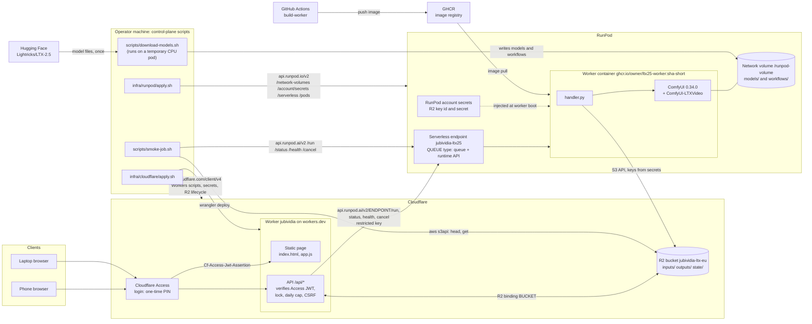
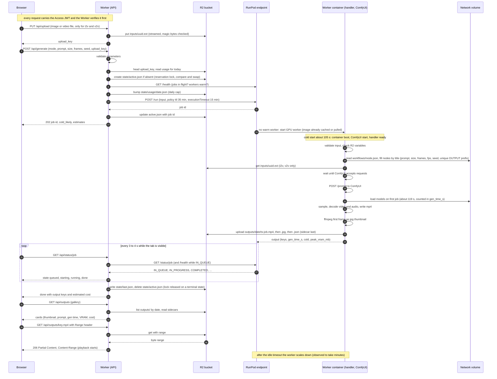
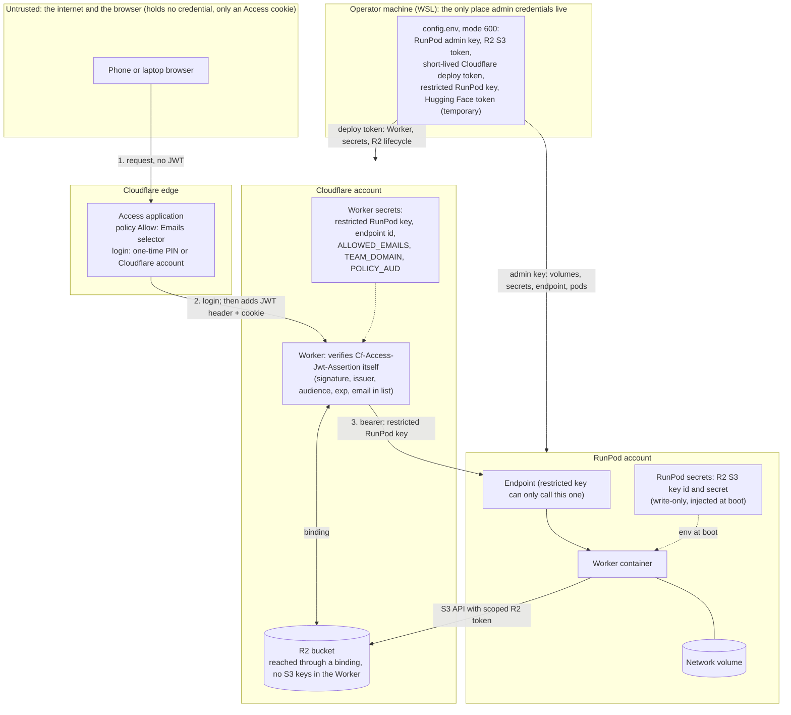
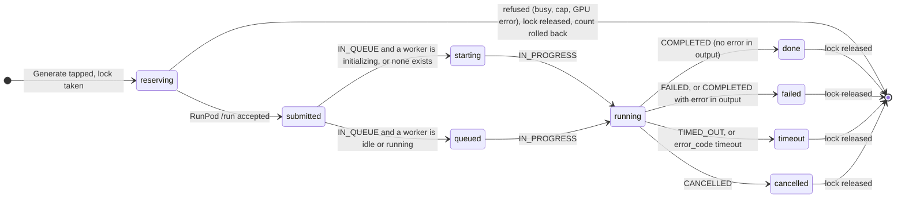
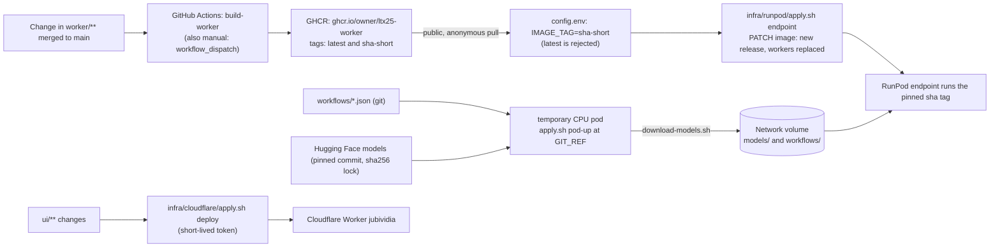
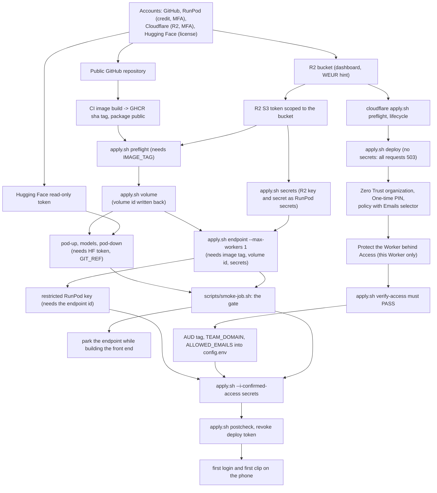

# Architecture

How jubividia is built, why each piece was chosen, what was measured, and how to operate it. The diagrams are written in Mermaid and render on GitHub.

Related documents: [setup-from-scratch.md](setup-from-scratch.md) (rebuild it), [configuration.md](configuration.md) (every setting and credential), and the design notes in `docs/decisions/` ([endpoint](decisions/endpoint.md), [ui](decisions/ui.md), [worker](decisions/worker.md), [models](decisions/models.md), [workflows](decisions/workflows.md)) with the validation reports in `docs/validation/`.

Contents:

1. [In one paragraph](#in-one-paragraph)
2. [Diagrams](#diagrams): (a) components, (b) one generation, (c) trust and authentication, (d) job states, (e) build and deployment, (f) setup order
3. [The components and why they were chosen](#the-components-and-why-they-were-chosen)
4. [Measured numbers](#measured-numbers)
5. [The two-user model and shared limits](#the-two-user-model-and-shared-limits)
6. [Known limitations](#known-limitations)
7. [Operations runbook](#operations-runbook)

## In one paragraph

A person opens a web page on a phone or laptop and logs in through Cloudflare Access. The page is served by one Cloudflare Worker that also exposes a small API. When the person taps Generate, the Worker checks the request, reserves the single job slot in a file in Cloudflare R2, and submits the job to a RunPod Serverless endpoint. RunPod starts a GPU worker container if none is awake; the container runs a handler that drives ComfyUI with the LTX-2.5 model files stored on a RunPod network volume, then uploads the video, a thumbnail and a JSON sidecar to R2. The page polls the Worker for progress, and plays the result straight from R2 through the Worker. Everything is created by small scripts from one config file, and the container image is built by GitHub Actions.

## Diagrams

### (a) System context and components



### (b) One generation, from tap to playback



### (c) Trust boundaries and authentication



What a leaked key could do (details and rotation in [configuration.md](configuration.md#credentials-scopes-least-privilege-and-rotation)):

| If this leaks | An attacker could | Limit |
|---|---|---|
| Browser session cookie | Use the page as that person until it expires | Daily cap 30, one job at a time, only the allowed addresses' sessions |
| A forged `Cf-Access-Jwt-Assertion` | Nothing: the Worker verifies the signature against Cloudflare's published keys | |
| Restricted RunPod key (in the Worker) | Submit, read and cancel jobs on the one endpoint | Cannot manage resources (`api.runpod.io/graphql` None); real concurrency capped by `workers.max` |
| RunPod admin key (operator machine) | Create or delete endpoints, pods, secrets, volumes; spend the balance | Held only on the operator machine; revoke in the console |
| R2 S3 token (RunPod secrets) | Read, overwrite, delete objects in that one bucket | Scoped to the bucket; cannot reach other buckets or the account |
| Cloudflare deploy token | Change Workers and R2 on the account | Short-lived; revoked after use; no Zero Trust scope |
| Hugging Face token | Download gated models as the owner | Read-only; revoked after the download |

### (d) Job states as the page shows them



Mapping table (`ui/src/status.js`):

| Page state | RunPod status | Rule |
|---|---|---|
| `queued` | `IN_QUEUE` | A worker is idle or running and none is initializing (the job is about to start) |
| `starting` (cold start) | `IN_QUEUE` | `workers.initializing > 0`, or no idle, running or initializing worker at all |
| `running` | `IN_PROGRESS` | Also used for any unknown status value, so a job is never dropped. The model load happens inside the first job, so the page cannot tell loading from generating |
| `done` | `COMPLETED` | The output carries no `error` |
| `failed` | `FAILED`; or `COMPLETED` with `error` in the output | Friendly text per error code; the raw `[code] message` is in a details expander |
| `timeout` | `TIMED_OUT`; or any error whose code is `timeout` | |
| `cancelled` | `CANCELLED` | |
| (failed, code `expired`) | HTTP 404 from `/status` | RunPod dropped the record; the page says to check the gallery |
| (net) | the Worker cannot reach RunPod | The page keeps polling with backoff |

The lock held in `state/active.json` has its own substates, `reserving`, `submitted` and `unknown` (a submit whose outcome is uncertain; it keeps the lock and the count, and is resolved through `/health` after 120 s). A terminal state writes `state/last.json` and releases the lock. Cancel keeps the lock until RunPod reports a terminal state.

### (e) Build and deployment pipeline



Key points: merging a change under `worker/**` (or the workflow file) to `main` builds and publishes the image automatically; the endpoint only changes when you set a new `IMAGE_TAG` and run `apply.sh endpoint`. Workflows and models are **not** in the image: they live on the volume and are updated separately. A contract change between the handler (in the image) and the workflows (on the volume) must ship as one release (see `workflows/README.md`, release checklist). The Worker is deployed by hand with `infra/cloudflare/apply.sh deploy`; there is no CI deployment of the Worker, and CI never holds Cloudflare or RunPod credentials (`.github/workflows/test.yml` runs only offline tests).

### (f) Setup order dependency diagram



Why this order: the volume must exist before the models can be written to it and before the endpoint can mount it; the image tag must exist before the endpoint can be created; the gate must pass before building the front end on top; and the Worker gets its secrets only after Access is proven to block anonymous requests, so there is never a moment when an open page could spend money.

## The components and why they were chosen

**Browser page (`ui/static/`).** Vanilla HTML, CSS and JavaScript, no build step, mobile first (one column, large tap targets, camera-roll file picker). Content-Security-Policy forbids inline scripts; prompt text from the gallery is inserted with `textContent`, never as HTML. Shared arithmetic (frame counts, limits, cost estimates) lives in `ui/static/calc.js`, used by both the page and the Worker so they cannot disagree. See [decisions/ui.md](decisions/ui.md).

**Cloudflare Access.** The front door. Chosen because it gives a real login (one-time PIN by email) for free on the Free plan (50 seats) and lets a Worker be protected without writing login code. The Worker also verifies the JWT itself, because the `ctx.access` helper is not available to a Worker that serves static assets (stated in the design note), and because it gives defence in depth if the Access application is ever misconfigured or the Worker is reached by another hostname. The Access application is created by hand in the dashboard: the deploy token has no Zero Trust scope on purpose, and a Terraform approach was rejected (provider support for a Worker destination could not be confirmed).

**Cloudflare Worker `jubividia` (`ui/src/`).** One Worker serves the page and the API (`/api/state`, `/api/upload`, `/api/generate`, `/api/status/<id>`, `/api/cancel/<id>`, `/api/outputs`, `/api/outputs/<key>`). It runs on `workers.dev` only, with preview URLs off. Every request, static files included, goes through it first (`run_worker_first`). State-changing requests need the custom header `X-Jubividia: 1` and a same-origin check; no CORS headers are ever sent. It holds only the restricted RunPod key. Why a Worker: it is free at this scale, lives next to R2 (binding, no S3 keys), and streams large videos with proper HTTP Range (206) support, which iPhone Safari needs to play video.

**R2 bucket `jubividia-ltx-eu`.** Holds uploads, results and the small state files (lock, daily counter). Chosen because egress is free, it is S3-compatible for the RunPod worker, and conditional writes (compare-and-swap) give an atomic one-job lock and counter with no extra database (no KV or D1). Layout and lifecycle rules: [configuration.md](configuration.md#r2-bucket-layout-and-lifecycle-rules).

**RunPod Serverless endpoint `jubividia-ltx25`.** GPU on demand, billed per second while a worker runs; nothing bills for the GPU when no worker runs (apart from the unconfirmed idle question). Type QUEUE because the handler uses `/run` and `/status` (the load-balancing type has a 5.5-minute processing cap and a 30 MB payload limit, and `/runsync` sits behind an edge timeout of about 100 seconds, so it is never used). Pinned to the RTX 6000 Ada (48 GB) in US-WA-1: no data center had A6000/A40 serverless stock together with network volumes, and the other 48 GB types in the same pool are excluded (the L40 and L40S and a Blackwell MIG slice) because they were untested for the int8-convrot model. GPU availability for 48 GB cards is low everywhere; a queued job costs nothing until a worker starts. The management API (`https://api.runpod.io/v2`) is used only by the operator scripts; the runtime API (`https://api.runpod.ai/v2/<endpoint-id>/...`) by the Worker and the smoke test. See [decisions/endpoint.md](decisions/endpoint.md).

**Worker container (`worker/`).** Base `runpod/worker-comfyui:5.10.0-base` (pinned by tag and digest; ComfyUI 0.34.0, Python 3.12, torch 2.11 cu128) plus ComfyUI-LTXVideo at a pinned commit, our `handler.py` replacing the stock handler, and `extra_model_paths.yaml`. No model weights inside. `constraints.txt` keeps rebuilds on the same package versions so the torch family cannot change. The handler validates input, fetches the input from R2, fills the workflow, drives ComfyUI over HTTP, makes a thumbnail with ffmpeg, uploads with bounded retries, and maps failures to error codes. The 5.11.0 base mentioned in the first design note does not exist as a `-base` tag; 5.10.0 was the newest published. See [decisions/worker.md](decisions/worker.md).

**ComfyUI and the workflows (`workflows/`).** Core ComfyUI nodes build the graphs; the LTXVideo pack is installed but no node from it is used. Three modes: text to video (t2v), image to video (i2v), and video continuation (v2v). v2v does **not** edit a clip: the last 25 frames of the input guide the start of a new clip that overlaps about one second of the source, with newly generated sound; it needs at least 33 frames. Defaults: 1280x704 (both multiples of 64 because the two-stage graph halves the size), 24 fps, 121 frames (5.04 s), with audio, two-stage distilled. A single-stage fallback exists but was not measured. See [decisions/workflows.md](decisions/workflows.md).

**Network volume (80 GB, US-WA-1, standard).** Holds the model files (41.43 GB default set) and the workflow templates, mounted at `/runpod-volume`. Models are never in the image so the image stays small and the models can change without a rebuild. Data center and tier cannot be changed, size can only grow, deleting it is irreversible (it costs a re-download). See [decisions/models.md](decisions/models.md).

**Models.** `Lightricks/LTX-2.5` at a pinned commit with a sha256 lock in `scripts/models.lock`: the int8-convrot distilled transformer and the int8-convrot Gemma 4 text encoder, VAEs and upscalers. The int8-convrot build was chosen in the original plan because the first target cards (A6000/A40, Ampere) have no FP8 tensor cores (from `docs/decisions/worker.md`); the final card, the RTX 6000 Ada, is a different generation, and no FP8 comparison was run. A community FP8 build of LTX exists but was not adopted (not benchmarked).

**GHCR and GitHub Actions.** The image is built in CI (the base is about 24 GB, too big for a typical laptop workflow) and published to GitHub Container Registry as `latest` and `sha-<short>`. The endpoint pins a `sha-` tag so a deploy is explicit and reversible.

**Control-plane scripts.** Idempotent bash scripts with a fixed-key config reader, `--dry-run`, read-back verification, redacted output and no code path that deletes the volume or the R2 secrets. Chosen over Terraform because no maintained provider covers RunPod endpoints, volumes and secrets, and the Cloudflare Access destination for Workers was unconfirmed in the provider. `infra/runpod/apply.sh` calls the RunPod management API; `infra/cloudflare/apply.sh` calls the Cloudflare API (`api.cloudflare.com/client/v4`) and runs `wrangler deploy`; `scripts/smoke-job.sh` calls the RunPod runtime API (and `aws` against R2 for its checks); `scripts/download-models.sh` runs on a temporary pod and calls Hugging Face.

**Tests (`tests/`, `ui/test/`, `.github/workflows/test.yml`).** Everything runs offline against fakes (a fake RunPod and GHCR on 127.0.0.1, a fake Cloudflare API, a mock Hugging Face server, workerd for the Worker with minted JWTs). CI runs them on every pull request and push to `main`, with no secrets.

## Measured numbers

From the real runs on 2026-10-29 on an RTX 6000 Ada in US-WA-1 (image `sha-f9bc90a`; gate **passed**). Sources: README "Measured" tables and `docs/decisions/ui.md`.

| Measurement | Value |
|---|---|
| Warm 5.04 s clip (1280x704, 121 frames, 24 fps) | generation about 68 s (68.21 s; second run 66.40 s); execution 70.9 s |
| First clip after idle, submit to done | about 291 s (291.5 s) |
| of which worker start | about 105 s (104.6 s) |
| of which model load (inside the first job) | about 119 s (118.6 s) |
| Cold start as the gate defines it (worker start + model load) | 223.2 s (above the 180 s flag, below the 600 s hard stop) |
| Peak VRAM, default clip | 43,473 MiB (about 42.5 GiB) on a 48 GB card; no out-of-memory; the 46 GiB line was never reached. (Some notes write "43.5 GiB"; that is 43,473 MiB read as thousands) |
| Output | h264 1280x704, 24 fps, 5.04 s video with AAC 48 kHz stereo audio, about 917 KB |
| Repeat of an identical request | 1.02 s, new output key (the per-job prefix fix works) |
| Cost per warm clip | about $0.034 at $1.75/h |
| Cost of the first clip after idle | about $0.09 to $0.14 (depends on whether worker start is billed) |
| Scale-down after the last job | about 6 minutes, although the idle timeout was 60 s (seen three times, cause unknown) |
| Model download (cpu3c, 2 vCPU) | 41.43 GB in 3 min 39 s (about 189 MB/s); full verify about 2 min 21 s |
| Volume | 80 GB x $0.07 = $5.60 per month |
| Spent in total at the time of the gate | about $0.46 of the $10 credit |
| Idle timeout set by Ken | 180 s |

The model load is part of the first job, so RunPod cannot separate "loading" from "generating"; both are `IN_PROGRESS`. The page says "Loading the model, then generating" when it knew at submit time that the GPU was asleep.

Not measured: sizes beyond 1280x704x121 (the page warns "untested"), offload (not detectable from job data and the worker logs were gone), FlashBoot benefit, a faster volume tier, the visual quality and continuity of v2v (read from the node source, not observed), the full gate duration, and HEVC `.mov` phone clips.

## The two-user model and shared limits

Two people (Ken and a second person) are listed in `ALLOWED_EMAILS` and in the Access policy. They log in with a one-time PIN sent to their own address (the Cloudflare identity provider would only admit members of the Cloudflare account). Everything is shared:

- one gallery (the sidecars in `outputs/`),
- one active job at a time (the lock records only a short hash of who started it; the page tells the other person to wait),
- one daily cap of 30 attempts per UTC day (resets at midnight UTC; the page shows the reset time in the viewer's local time),
- one GPU endpoint and one bill.

Each person sees "Signed in as ..." in the header. Private galleries would need an owner field from the worker (a later change). Either person can cancel the other's running job (two trusted users).

## Known limitations

- Only one job at a time and 30 attempts per day (failed attempts count).
- The first clip after the GPU slept takes about 4 to 5 minutes; a warm clip about 1 to 1.5 minutes.
- Idle-time billing is unconfirmed, and workers have taken minutes longer than the idle timeout to scale down (cause unknown).
- 48 GB GPU stock is low; a job can wait in the queue with no worker. The data center is fixed by the volume (US-WA-1); moving needs a new volume and a 41 GB download.
- Measured size is 1280x704x121 only. Larger sizes are allowed up to the handler maximum (2048 per side, 481 frames) but are untested and may fail or run out of memory; a failed run still bills.
- Uploads are limited to 95 MB (video) and 20 MB (image) because of the Cloudflare plan's 100 MB request limit; chunked upload is a later change. JPEG, PNG, WebP, MP4 and MOV only; WebM and HEIC are refused. Whether HEVC `.mov` from iPhones decodes in the video loader is unverified.
- v2v is a continuation, not an edit: the new clip overlaps about one second of the source and has new audio, so joining the two has an audible seam.
- Cancelling a running job may not stop the GPU immediately (unverified); the lock stays until RunPod reports a terminal state.
- After a quiet week RunPod lowers the endpoint's maximum workers (to 2 after 3 days, to 0 after 7) and jobs fail with a paused error until `apply.sh endpoint` is run.
- The volume can be removed by RunPod if the balance reaches $0.
- The Cloudflare tool needs an existing second Worker (`jubilab-website`) in the account (see [setup-from-scratch.md](setup-from-scratch.md), section 2.3).
- `npm run dev` answers 503 locally by design (no bypass exists); local behaviour is covered by the test suite.
- The `Workflow version` marker ties the handler (in the image) to the workflows (on the volume); they must be released together.

## Operations runbook

All commands run in the repository root in WSL. Add `--dry-run` first if unsure. If `config.env` is not in the repository root, prefix with `env CONFIG_ENV=/full/path/to/config.env`.

### Check the endpoint and worker state

- Summary of volume, secrets, endpoint, temporary pod (read-only):

```
infra/runpod/apply.sh status
```

It prints the endpoint image, `workers min/max`, idle timeout, FlashBoot, timeout, and warns if the maximum differs from `RUNPOD_WORKERS_MAX` (RunPod lowered it) or if the temporary pod `jubividia-models-tmp` is still alive and billing.

- Live worker counts and queue: the Worker's own `GET /api/state` (shown as the GPU badge and worker numbers on the page), or `GET https://api.runpod.ai/v2/<endpoint-id>/health` with a bearer key (returns `workers.idle|running|initializing|throttled|unhealthy` and `jobs.inQueue|inProgress`). The RunPod console's endpoint page shows the same plus worker logs (where to look for offload or errors).
- A job's state: `GET https://api.runpod.ai/v2/<endpoint-id>/status/<job-id>`.

### Park and unpark the endpoint

"Parking" means no GPU can start, so nothing can bill. `infra/runpod/apply.sh` deliberately refuses maximum workers 0 (`workers min/max invalid (max >= 1 ...)`), so park through the RunPod console or the API.

Park:

- RunPod console, Serverless, the endpoint `jubividia-ltx25`, edit, set **Max workers** to 0 (and Min to 0) and save (menu wording not verified); or
- API: send a PATCH to `https://api.runpod.io/v2/serverless/<endpoint-id>` with the admin key as bearer token and the body `{"workers":{"min":0,"max":0,"idleTimeout":<your idle seconds>}}`. This is the same body and route that `apply.sh teardown-endpoint` sends before deleting the endpoint. Running it by hand has not been verified; do not paste the key into a command line that is saved in shell history (let Claude Code run it, or read the key from a variable).

While parked, `/run` answers HTTP 409 (paused) and the Worker shows "The GPU service refused the job ... may be paused". Running workers stop after finishing.

Unpark:

```
infra/runpod/apply.sh endpoint
```

It compares the endpoint with `config.env`, patches only the `workers` group back to the configured min, max and idle timeout, and reads it back (`ok   endpoint <endpoint-id> matches config on every owned field`). Use `--max-workers 1` for a one-worker run (for example the gate).

Note: creating the endpoint started a worker immediately even with minimum 0, so check `status` and the console right after creating it.

### Read billing

RunPod console, Billing (menu wording not verified): hourly buckets per endpoint, volume and pod. The REST API cannot read the balance. Compare against the page's per-clip estimates (`gen_time_s` x $1.75 / 3600). To settle the open question about idle-time billing, look at an hourly bucket after a day with known worker lifetimes. The gate also writes timings to `docs/validation/endpoint-timings.csv` (local file).

### Rotate each key

See the table in [configuration.md](configuration.md#credentials-scopes-least-privilege-and-rotation). In short: R2 token -> `infra/runpod/apply.sh secrets --rotate` (reaches workers at next boot); restricted RunPod key -> new key, `UI_RUNPOD_API_KEY`, `infra/cloudflare/apply.sh --i-confirmed-access secrets` with a new short-lived Cloudflare token; admin key -> replace in `config.env`, delete the old; Hugging Face token -> revoke after every download; Cloudflare token -> revoke after every deploy.

### Deploy a new worker image tag

1. Change the code under `worker/` and merge to `main` (or run the workflow by hand: `gh workflow run build-worker.yml`). The `test` workflow runs the offline tests on the pull request.
2. Wait for the `build-worker` run to succeed (`gh run list --workflow build-worker.yml --limit 3`). The new tag is `sha-` plus the first 7 characters of the built commit. The package stays public.
3. Put it in `config.env` as `IMAGE_TAG=sha-<short>`.
4. Preview: `infra/runpod/apply.sh --dry-run endpoint`. Apply: `infra/runpod/apply.sh endpoint`. The tool announces "an image/env change creates a new release and replaces workers".
5. Prove it: send one clip from the page, or run `scripts/smoke-job.sh` (billable; see the setup guide).
6. Roll back by setting the previous `sha-` tag and running `apply.sh endpoint` again.

If the handler and the workflows change together, update the volume as well (next section) and release them as one unit.

### Update the workflows on the volume

The workflow templates are copied to `/runpod-volume/workflows/` by `scripts/download-models.sh --workflows-only`, which needs the volume mounted, so it must run on a pod.

1. Edit `scripts/build-workflows.py` and regenerate (`make -f scripts/workflows.mk build-workflows`), bump the workflow version in the script and in `workflows/README.md` together, run `make -f scripts/workflows.mk test-workflows`, commit and **push to GitHub**.
2. Set `GIT_REF` in `config.env` to the new full commit hash and put a fresh read-only Hugging Face token in `HF_TOKEN` (`pod-up` requires it).
3. Park the endpoint if you do not want a GPU worker reading the volume during the change (optional: the copy replaces small files).
4. `infra/runpod/apply.sh pod-up`, wait for `MODELS DONE` in `infra/runpod/apply.sh pod-logs` (the default run downloads nothing that is already there, re-verifies, and syncs the workflows), then `infra/runpod/apply.sh pod-down`. If you prefer, create a pod by hand with the volume attached and run `scripts/download-models.sh --workflows-only` there (JSON is validated before copying).
5. Revoke the Hugging Face token, unpark the endpoint, send one test clip.

### Change the idle timeout

Edit `RUNPOD_IDLE_TIMEOUT_S` in `config.env` (1 to 3600), then `infra/runpod/apply.sh endpoint` (patches the `workers` group, no worker replacement). Two other places assume 180 s and should be changed together if you move far from it: the page's worst-case cost uses `IDLE_TAIL_S = 180` in `ui/static/calc.js` (changing it needs a Worker redeploy), and `scripts/smoke-job.sh` prints a fixed "idle timeout 60 s" message and waits at most 600 s (`SMOKE_IDLE_WAIT_S`) for scale-to-zero.

### Add or remove an allowed user

1. Edit `ALLOWED_EMAILS` in `config.env` (comma-separated).
2. Update the **Access policy** in the dashboard: Zero Trust, Access controls, Policies, the policy attached to the Worker, Emails selector, add or remove the address. Use the full policy editor, never a whole domain. The Free plan allows 50 seats.
3. Create a new short-lived Cloudflare deploy token (setup guide section 8.1), put it in `config.env`, and run `infra/cloudflare/apply.sh --i-confirmed-access secrets`. This re-sets all five Worker secrets, including the new `ALLOWED_EMAILS`; it re-runs `verify-access` first. Then revoke the token.
4. The Worker rejects a removed address immediately after step 3 (it checks the JWT email against the list); the person's Access session cookie may remain until it expires or is revoked in the dashboard (revocation steps not verified).

### Teardown and undo

Undo in this order. None of this is automatic, and the volume is deliberately never deleted by a script.

1. **Stop spending now**: park the endpoint (above), or delete the Worker secret `RUNPOD_API_KEY` (this alone stops all page-initiated spend): dashboard (Workers & Pages, `jubividia`, Settings, Variables and Secrets) or `cd ui && npx wrangler secret delete RUNPOD_API_KEY --name jubividia`.
2. **Cloudflare**: `infra/cloudflare/apply.sh teardown` prints the exact steps (it makes no call): remove the Access application in the dashboard (or leave it: without secrets the Worker answers 503), delete the secrets, `cd ui && npx wrangler delete --name jubividia` (never another name; recreating the Worker orphans an Access application bound to the old Worker id), optionally remove lifecycle rules (`npx wrangler r2 bucket lifecycle remove jubividia-ltx-eu --name <rule>`), revoke the Cloudflare token and delete it from `config.env`. Deleting the R2 bucket is a dashboard action (not scripted; delete its objects first, not verified).
3. **RunPod endpoint**: `infra/runpod/apply.sh teardown-endpoint --yes` sets maximum workers to 0 and deletes the endpoint; the volume and secrets stay. Re-create later with `infra/runpod/apply.sh endpoint`.
4. **Temporary pod**: `infra/runpod/apply.sh pod-down` (terminates it and deletes `hf_token_tmp`).
5. **Secrets and volume** (console only): delete `ltx_r2_access_key_id` and `ltx_r2_secret_access_key` under account secrets; deleting the volume loses the 41 GB of models and ends the $5.60 monthly cost. A re-download needs a new temporary pod and a Hugging Face token.
6. **Keys**: revoke the restricted and admin RunPod keys, the R2 S3 token, and any Hugging Face token. Delete the GHCR package and disable the workflow if you also want to remove the image.
